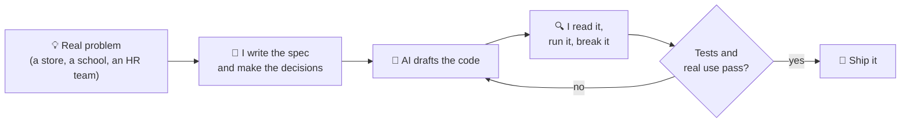

[]

 

## 👋 About Me

I'm **Deps**, a BSIT graduate (ZPPSU, 2026) and full-stack developer from Zamboanga City, Philippines.

I build with **AI as my pair programmer**. I decide what to build and why, the AI helps me write and refactor the code, and I review, run and test everything before it ships. I like turning messy, manual business processes into software people actually want to use: recruitment dashboards, enrollment systems, POS apps, and database-driven platforms.

- 🎯 Currently building **business & recruitment systems**
- 🤖 Daily tools: **AI coding assistants (Claude Code)**, plus prompt engineering to get better results from them
- 🛒 Shipped **TindaPOS**, an offline-first POS for sari-sari stores, and **RigUninstaller**, a free Windows uninstaller
- 🛠️ I also build PCs, troubleshoot hardware, and take a little **freelance repair** on the side
- 🎨 For fun: **generative art & 3D modeling in Blender** (you'll find me as Bubblez360)

**Open to:** Full-Stack / Junior SWE roles · IT & Technical Support · Freelance web projects

 

## 🤖 How I Build With AI

I'm open about it: most of my recent projects are built with AI assistance. What makes that work is the loop, not the tool.

<table>
<tr>
<td width="50%" valign="top">

**What I own**

- What gets built, for whom, and what is left out
- Architecture and data-model decisions
- Reading and reviewing every change
- Testing and edge cases (RigUninstaller has **840+** automated tests)
- UI polish: modals, dropdowns, dark/light themes
- Tracing a bug to its root cause, not patching the symptom

</td>
<td width="50%" valign="top">

**What AI helps with**

- First drafts and boilerplate
- Refactors and repetitive edits
- Writing tests and docs
- Explaining unfamiliar code and libraries
- Suggesting fixes I then verify

</td>
</tr>
</table>

## 🫡 Tech Stack

**Languages**

**Frontend**

**Backend & Databases**

**Tools & Creative**

> **IT & Hardware:** PC diagnostics · assembly & upgrades · troubleshooting · OS installation · workstation & peripheral setup · system maintenance · basic laptop servicing
>
> **Also:** REST APIs · prompt engineering & AI-assisted development · Canva · Cisco networking basics · OBS Studio & Streamlabs

## 🏆 Featured Projects

<table>
<tr>
<td width="50%" valign="top">

### 🛒 TindaPOS
**Offline-first POS for sari-sari stores**

Fast, thumb-friendly point of sale for a Filipino tindahan: cash and GCash sales, stock tracking, shift reports, backup and restore, and a Taglish interface. Installs like an app and keeps working without internet.

`React` `Zustand` `IndexedDB` `Supabase` `PWA`

[**🔗 View Repo**](https://github.com/Bubblez360/SimplePosSystem) · [**▶ Live demo**](https://bubblez360.github.io/SimplePosSystem/)

</td>
<td width="50%" valign="top">

### 🧹 RigUninstaller
**Windows uninstaller and cleaner**

Removes programs, finds the leftovers, warns before you remove drivers or runtimes, cleans temp files and caches, and can undo with backups and restore points. 840+ automated tests.

`C#` `.NET 8` `WPF` `xUnit`

[**🔗 View Repo**](https://github.com/Bubblez360/RigUninstaller) · [**⬇ Download**](https://github.com/Bubblez360/RigUninstaller/releases/latest)

</td>
</tr>
<tr>
<td width="50%" valign="top">

### 👨‍💼 Upstaff
**Recruitment / HR System**

Applicant dashboard + core HR flows: role-based auth, leave requests with credit deduction, document upload/preview, and email notifications.

`PHP (MVC)` `JavaScript` `MySQL` `Supabase` `Vercel`

[**🔗 View Repo**](https://github.com/Bubblez360/Upstaff_dashboard_nideps)

</td>
<td width="50%" valign="top">

### 🎓 Sta. Maria Enrollment
**School Enrollment System**

Enrollment automation that cut manual paperwork and sped up record retrieval, with validation throughout.

`PHP` `MySQL`

[**🔗 Frontend**](https://github.com/Bubblez360/enrollment-frontend) · [**🔗 Backend**](https://github.com/Bubblez360/enrollment-back1-)

</td>
</tr>
<tr>
<td width="50%" valign="top">

### ☕ Coffee POS
**Point-of-Sale System**

POS for a small coffee business: transaction processing, user auth, and a streamlined cashier flow.

`PHP` `JavaScript` `HTML` `CSS`

[**🔗 View Repo**](https://github.com/Bubblez360/depsa)

</td>
<td width="50%" valign="top">

### 🎨 Bubz Artwork
**Personal Art Gallery**

A gallery site for my generative art and characters, with a community wall feature.

`HTML` `CSS` `JavaScript`

*In progress*

</td>
</tr>
</table>

Most of my recent projects are built with AI assistance. I write the specs, review the code and own the testing.

## 💼 Experience

**💼 Upstaff Intern – Upstaff Recruitment Management System** · *March – June 2026*
- Built a centralized applicant-information and assessment dashboard with API integration and document handling
- Shipped HR flows: role-based auth, leave requests with credit deduction, document upload/preview and email notifications

**🧑‍💻 Broadcast & Creative Intern – Radyo iFM Music & News Zamboanga** · *May – July 2023*
- Ran live-stream broadcasts with OBS Studio and Streamlabs
- Assisted in event production and media operations
- Designed promotional assets in Canva and Figma

**🖥️ Administrative Intern – ZPPSU Senior High School, Zamboanga** · *May – July 2022*
- Digitized and organized student enrollment records
- Improved data-retrieval processes and maintained filing systems

## 🎓 Education

**BS Information Technology – Zamboanga Peninsula Polytechnic State University (ZPPSU)** · *2026*  
**Cisco Networking Basics** · *2024*

## 🐍 Activity

<picture>
  <source media="(prefers-color-scheme: dark)" srcset="https://raw.githubusercontent.com/Bubblez360/Bubblez360/output/github-contribution-grid-snake-dark.svg">
  <source media="(prefers-color-scheme: light)" srcset="https://raw.githubusercontent.com/Bubblez360/Bubblez360/output/github-contribution-grid-snake.svg">
  
</picture>

## 🎯 Beyond Code

When I'm not shipping, I'm building PCs, breaking down hardware problems, or making generative art and 3D models in Blender. Same instinct, different canvas: figure out how the thing works, then make it better.

> *"Building practical technology that solves real-world problems."*

